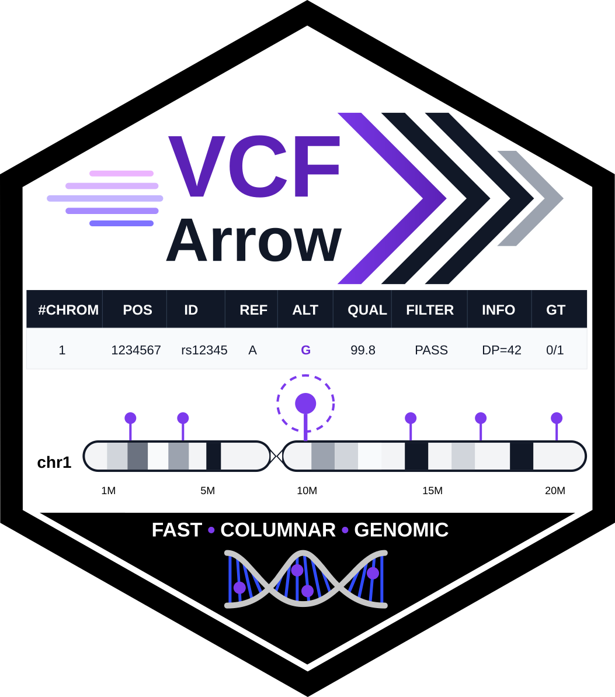

# VCFArrow 

# Installation

The released version can be installed from CRAN with
`install.packages("VCFArrow")`, and the development version from GitHub
with `pak::pak("legalLab/VCFArrow")` or
`devtools::install_github("legalLab/VCFArrow")`. Two packages are
optional and only needed for specific functions: `adegenet`, for
[`vcf2genlight()`](https://legallab.github.io/VCFArrow/reference/vcf2genlight.md),
and `svglite`, for SVG plots (without it, SVG plots are written with R’s
own Cairo device). Install them with
`install.packages(c("adegenet", "svglite"))`.

The package is built around [Apache Arrow](https://arrow.apache.org/),
accessed through the `arrow` R package.

# Introduction

This package has six main functionalities: (1) reading in and writing
out VCF data files, including precalculation of diverse metrics used in
the filtering functions; (2) data filtering functions; (3) merging VCFs;
(4) subsetting VCFs; (5) generation of summary statistics and graphs;
and (6) data transformation and writing out of other data formats
(population genetic and phylogenetic formats) for downstream analyses.
This package is a reimagination of the
[`vcf2others`](https://legallab.github.io/vcf2others/) package. Same as
`vcf2others`, it uses the Apache Arrow library functions to manipulate
SNP data via dplyr verb equivalents. However, unlike `vcf2others`,
`VCFArrow` now reads in the VCF data file into an S4 R object
constructed around an Apache Arrow data structure. It precalculates a
number of metrics and stores them in the S4 object. The VCF genotype
matrix is stored as a long tidy table, and the data in the S4 object are
lazy loaded. Many common tasks have been delegated to shared, C++ backed
APIs and functions, and these operations have been parallelized when
possible. These modifications and optimizations now permit extremely
fast data filtering, manipulation and transformation. It is possible to
process VCFs comprising tens of millions of SNVs and hundreds of
individuals in a matter of seconds to minutes with minimal RAM overhead.
A comparison of `VCFArrow` with `vcftools`, `vcfR` and `tidypopgen` on a
dataset of 18.6 million variants and 56 samples (run time, memory, and
what each tool computes for the same function) is available in
[VCFArrow, vcftools, vcfR and tidypopgen
compared](https://github.com/legalLab/VCFArrow/blob/main/comparison/tool_comparison.md).

## Cookbook

How to use the functions of this package with examples of common
workflows is available in the
[vignette](https://legallab.github.io/VCFArrow/).

## Meta

- Please [report here any issues or bugs or
  suggestions](https://github.com/legalLab/VCFArrow/issues).
- License: MIT.
- Get citation information for `VCFArrow` in R by running
  `citation(package='VCFArrow')`.

## News

The Github version is ahead of CRAN. It updates
[`vcf_theta()`](https://legallab.github.io/VCFArrow/reference/vcf_theta.md)
and
[`vcf_stats()`](https://legallab.github.io/VCFArrow/reference/vcf_stats.md)
with the small-sample correction n/(n - 1) when calculating Pi, and adds
to
[`vcf_stats()`](https://legallab.github.io/VCFArrow/reference/vcf_stats.md)
each sample’s inbreeding coefficient F (the method-of-moments estimate
of vcftools and PLINK) and its mean per sample group.
